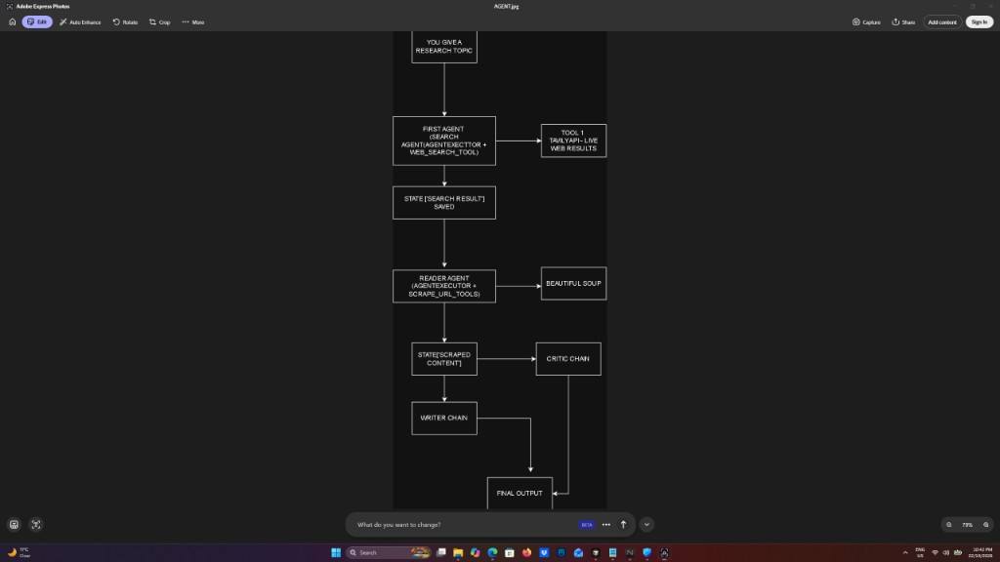

# Multi-Agent-Research

An AI research assistant where multiple agents collaborate to turn a topic into a sourced, scored report.

**Live demo:** https://multi-agent-research-peach.vercel.app/

## Steps used to create this

**Step 1 — Environment Setup**
Create a virtual environment, install all the libraries from `requirements.txt`, and create the `.env` file with your OpenAI and Tavily API keys.

**Step 2 — Create `tools.py`**
Build 2 custom tools using the `@tool` decorator. First, the web search tool, which talks to the Tavily API and fetches live search results from the internet. Second, the `scrape_url` tool, which takes a URL, visits that page and extracts clean readable text from it using BeautifulSoup.

**Step 3 — Create `agents.py`**
This is the heart of the project. We build 4 things here:
1. The **Search Agent**, using a LangChain agent with the web search tool.
2. The **Reader Agent**, using the same pattern but with the `scrape_url` tool.
3. The **Writer Chain**, using the modern LCEL pipe syntax: `prompt | llm | StrOutputParser()`. It takes all the research and writes a full report.
4. The **Critic Chain**, again using an LCEL pipe. It reads the report and gives a score and feedback.

**Step 4 — Create `pipeline.py`**
This is the supervisor. We write one function called `run_research_pipeline` that calls all 4 agents and chains in the correct order and passes results between them using a shared `state` dictionary. At the end of each step it prints the output in the terminal so you can see exactly what each agent is doing.

**Step 5 — Run and Test**
Run `python pipeline.py` in the terminal, enter a research topic and watch all 4 agents work one by one: search, read, write, review. The final report is printed with the critic's feedback right in the terminal.

## How the agent works

1. **Search agent** takes the research topic and uses the Tavily API to pull live web results.
2. **Reader agent** picks the most relevant result and scrapes the page with Beautiful Soup.
3. **Writer chain** drafts a report (Introduction, Key Findings, Conclusion, Sources).
4. **Critic chain** reviews the report and gives a score out of 10 with feedback.

## Tech stack

- **Frontend:** React, TypeScript, Vite, Tailwind CSS
- **Backend:** Python, FastAPI, JWT auth, MongoDB
- **AI:** LangChain, OpenAI (`gpt-4o-mini`), Tavily, Beautiful Soup
